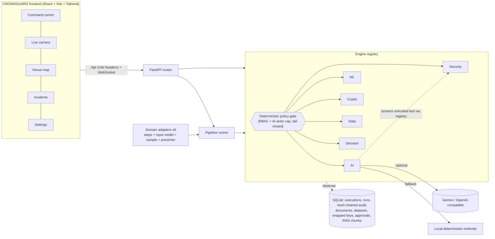

# CROWDGUARD — live crowd monitoring and safe-route guidance

CROWDGUARD watches a venue floor through a camera and shows, on a top-down map, where people are, where the floor is still free, where it is
getting congested, and which exit to send people to. It detects people with YOLO, keeps each person's identity with ByteTrack, projects their
feet onto the floor through a calibration, and updates the map several times a second over a WebSocket. Alerts and routes are advice for
organisers; nothing is acted on automatically.

It is built on the OMNIFORGE engine framework (part 2 below). The backend engines are unchanged; the frontend is now CROWDGUARD only.

| Screen | What it is for |
|---|---|
| **Command centre** | The live map: people, movement, density, free floor, unobserved floor, exits and the recommended route. Source, map layers, zones and exits on the left; area, alerts and route on the right; processing rate, counts, frame time and camera health along the bottom. |
| **Live camera** | The analysed frame with detection boxes and foot points. Calibrate the floor here by clicking four corners of a measured rectangle. |
| **Venue map** | Draw the monitored area: walkable outline, obstacles, zones (optionally restricted), exits, grid size and density thresholds. A second tab replays a zone-level simulated festival with forecasts. |
| **Incidents** | Open an incident from a live alert, record each decision, and check the hash-chained record and audit trail. |
| **Settings** | Theme (light, dark or system), operator name and role, detector and device status, and how to read the numbers. |

Documentation:

* Real-time pipeline, coordinate systems, measured performance, limits: [`docs/CROWDGUARD_REALTIME_ARCHITECTURE.md`](docs/CROWDGUARD_REALTIME_ARCHITECTURE.md)
* Overall architecture and the zone-level model: [`docs/CROWDGUARD_ARCHITECTURE.md`](docs/CROWDGUARD_ARCHITECTURE.md)
* Test results and raw measurements: [`docs/CROWDGUARD_TEST_RESULTS.md`](docs/CROWDGUARD_TEST_RESULTS.md)
* Two-minute pitch: [`docs/CROWDGUARD_PITCH.md`](docs/CROWDGUARD_PITCH.md)
* Calibration mathematics (VCIE): [`docs/VIRTUAL_HEATMAP_ARCHITECTURE.md`](docs/VIRTUAL_HEATMAP_ARCHITECTURE.md)

## Set up and run

Prerequisites: Python 3.11+ (tested on 3.12), Node 20+ (tested on 26), a webcam for live use. Camera capture uses DirectShow or Media
Foundation on Windows and OpenCV's default backend elsewhere; only Windows 11 has been tested.

```bash
# 1. Backend dependencies (includes opencv-python, ultralytics, networkx, websockets)
cd backend
python -m pip install -r requirements.txt

# 2. Build the frontend once; the backend serves it
cd ../frontend
npm install
npm run build

# 3. Start the server
cd ../backend
python -m uvicorn app.main:app --host 127.0.0.1 --port 8000
```

Open <http://127.0.0.1:8000>. The app opens on the Command centre with nothing monitored: every part of the floor is marked *not observed*.

**Model weights.** The person detector loads `yolov8n.pt` from disk; the repository root ships it (Ultralytics, AGPL-3.0). To use another
file, set `CROWDGUARD_YOLO_WEIGHTS=/path/to/weights.pt` or put it in `backend/models/`. Nothing is downloaded at runtime (`YOLO_OFFLINE` is
forced). Settings shows which file loaded, whether a test inference passed, and whether it runs on GPU (CUDA) or CPU. Without weights the
detector falls back to OpenCV HOG and says so.

**Frontend development** (hot reload): run the backend on port 8000, then `cd frontend && npm run dev` and open <http://localhost:5173>.
The dev server proxies `/api` and the WebSocket to port 8000.

## Monitor a camera

1. **Command centre → Source → Camera.** CROWDGUARD lists the cameras it can open. Pick one and select **Start camera**.
   * *Camera could not be opened*: it is disconnected, used by another application, or blocked by the OS privacy settings
     (Windows: Settings → Privacy & security → Camera → allow desktop apps). Close the other application or change the setting, then refresh the list.
   * *Opens but returns no frames*: usually another application holds it.
   * *Camera slow* alert: the camera delivers under 3 frames per second, often because another application shares it.
2. **Live camera → Floor calibration.** Put a rectangle on the floor (tape, tiles or a rug), select **Mark floor corners**, and click its
   corners in order: far left, far right, near right, near left. Enter its real width and depth, tick *I measured these distances*, and select
   **Apply calibration**. Until you do this, positions use an assumed calibration and densities are a relative index (1 means congested),
   not people per m².
3. **Venue map → Monitored area layout.** Draw the walkable floor, obstacles, zones and exits to match the room, then **Save layout**.
   Mark a zone *restricted* to keep routes out of it.
4. Back on the **Command centre**, the map updates as people move. **Route from a point** lets you choose where the route starts; otherwise
   it starts from the busiest zone. If staff report an exit blocked, mark it in the **Exits** list; guidance then avoids it.

**Other sources**, on the same Source panel:

* **Stream**: an RTSP or HTTP camera URL. Credentials are kept on the server and never displayed.
* **Recording**: upload a video, or select **Add test clip**. It plays at its own speed and is always labelled *Recording*, never live.
* **Simulation**: simulated pedestrians in four scenes, labelled *Simulation* everywhere. Use it when no camera is available.

## Measured performance

On a laptop with a 13th Gen Intel Core i7-13700HX, CPU only (no CUDA), YOLOv8n, through the real API and WebSocket
(details and raw output in the docs above):

| Source | Analysed | Processing per frame (median) | Capture to browser (median / p95) |
|---|---|---|---|
| Webcam 1280×720, default cap of 12 fps | 12.0 fps of 30 delivered | 26 ms | 46 / 62 ms |
| Webcam 1280×720, uncapped | 29.2 fps of 30 delivered | 29 ms | 46 / 61 ms |
| Recorded clip 640×678 | 12.0 fps | 33 ms | 71 / 101 ms |
| Simulation, 60 people | 9.9 fps (its native rate) | 19 ms | 24 / 34 ms |

The webcam frames were not viewed during measurement, so these are speed figures, not accuracy figures. Not verified on hardware: physically
unplugging a camera (covered by tests with a fake source), an RTSP camera, and GPU inference.

## Tests

```bash
cd backend && python -m pytest -o addopts="" -q     # 145 tests, including 24 for the real-time pipeline
cd frontend && npm run lint && npm run build        # oxlint (0 warnings) and type-checked build
```

## Safety limits

* Counts and densities are camera estimates. People hidden behind others are missed, so dense crowds are under-counted.
* Floor the camera cannot see, or any floor while the feed is down, is shown as *not observed*, never as empty, and routes avoid it.
* People per m² are shown only after a measured calibration.
* Routes never pass through obstacles, restricted zones, congested floor (unless there is no alternative, which is stated) or exits staff
  marked unavailable. Software never closes an exit.
* CROWDGUARD does not certify that an event is safe. Organisers decide.

---

# Part 2 — the OMNIFORGE backend framework

OMNIFORGE is a reusable foundation for turning a problem statement into a working AI-powered prototype quickly.
It has **one** FastAPI backend with six engines (AI, ML, cryptography, security, data and decision) behind a common
contract, and **nine domain adapters**. Each adapter is a declarative pipeline over those engines, not a separate app. CROWDGUARD adds a
seventh `crowd` engine and a tenth `crowd_safety` adapter. The multi-domain workspace UI is no longer part of the shipped frontend; the
domain pipelines remain available through the API and the interactive docs at `/docs`.

> **Status:** foundation mode. All nine pipelines run end to end on bundled **synthetic** data. No LLM key was present
> while this was built, so every AI step was exercised through its **labelled local fallback**. The Gemini and
> OpenAI-compatible provider code paths have unit tests that use a fake provider; they have **not** been checked against a live API.

---

## 1. Configuration

Setup and run commands are in the CROWDGUARD section above. Interactive API docs are at <http://127.0.0.1:8000/docs>.

**Optional configuration:** copy `.env.example` to `.env` (repository root or `backend/`).

| Variable | Purpose |
|---|---|
| `GEMINI_API_KEY` (+ `GEMINI_MODEL`) | Enables Gemini. Check the current model id at ai.google.dev/gemini-api/docs/models; the default `gemini-3.5-flash` has not been verified in this environment. |
| `OPENAI_API_KEY` + `OPENAI_MODEL` (+ `OPENAI_BASE_URL`) | Any OpenAI-compatible server: OpenAI, Groq, OpenRouter, Ollama, LM Studio, vLLM… |
| `AI_PROVIDER` | `auto` (the first configured provider) \| `gemini` \| `openai` \| `local` |
| `OMNIFORGE_MASTER_KEY` | base64 of a 32-byte key-encryption key. Without it, a dev key file is generated in `backend/.data/`. |

After adding a key, restart the backend and call `POST /api/engines/ai/ping` (or use `/docs`). This makes one real call and marks the provider *verified*.

**Tests:** see the CROWDGUARD section above (145 backend tests).

---

## 2. Architecture



**Layers (each depends only on the one below it):**

| Layer | Location | Responsibility |
|---|---|---|
| Presentation | `frontend/src` | The CROWDGUARD screens. Adapter results also carry a `presentation` contract (metrics, charts, tables, narrative) that any client can render. |
| API | `backend/app/api` | HTTP, identity context, upload sniffing. Delegates everything else. |
| Domain adapters | `backend/app/domains` | Declarative pipelines: `Step(engine, operation, build(ctx))` plus a presenter |
| Engines | `backend/app/engines/*` | Independently testable capabilities exposed as typed operations |
| Core | `backend/app/core` | `BaseEngine`, the `@operation` decorator, `EngineRegistry`, the response contract |
| Persistence | `backend/app/db` | The `Store` facade over SQLAlchemy/SQLite. Engines never touch sessions directly. |
| Composition root | `backend/app/services.py` | The only place where concrete classes are wired together (dependency injection) |

### Universal engine contract

Every operation, whether called from the API, a pipeline or another engine, returns the same envelope:

```json
{ "success": true, "engine": "crypto", "result": {}, "confidence": null,
  "execution_time_ms": 1.9, "warnings": [], "metadata": {"operation": "hash", "request_id": "…"}, "error": null }
```

`confidence` is `null` unless it can be computed meaningfully: classifier probabilities (labelled *uncalibrated*) or the
decision engine's agreement × coverage heuristic (labelled *heuristic*). `error` (`{code, message, details}`) is the
one addition to the base contract. HTTP status codes match the outcome: 403 policy, 404 unknown, 422 validation, 503 no provider.

Each operation declares a Pydantic input model, which handles validation and also produces the JSON schema published at `/docs` and `GET /api/engines/{name}`. It also declares an access level
(`read` / `write` / `sensitive`) and a permission string. The registry runs the policy check **before** validation and execution.

### Engines

| Engine | Operations (non-read access shown) | Implementation |
|---|---|---|
| `security` | `threat_scan`, `prompt_injection`, `validate`, `authorize`, `policy`, `events` | Transparent regex + URL heuristics with noisy-OR scoring. Every finding names its rule. |
| `ai` | `summarize`, `explain`, `simplify`, `structured`, `generate`, `rag_index` (write), `rag_query`, `rag_collections`, `providers`, `ping` | Provider abstraction (Gemini SDK; OpenAI-compatible over HTTP). TF-IDF RAG. Local fallbacks: extractive summary, template explanation, rule-based plain language. |
| `ml` | `classify`, `regress`, `predict`, `cluster`, `anomaly`, `forecast`, `text_classify`, `evaluate`, `list_models` | scikit-learn. Metrics are always reported **next to a naive baseline**. The forecaster picks a model on a validation window and reports on a later, untouched test window. |
| `crypto` | `hash`, `hmac`, `generate_key` (write), `encrypt` (write), `decrypt` (sensitive), `sign` (sensitive), `verify`, `merkle_root`, `merkle_verify`, `verify_document`, `list_keys` | `cryptography` + `hashlib` only: AES-256-GCM, Ed25519, HMAC-SHA256, RFC 6962-style Merkle tree. Key material is envelope-encrypted under a KEK. |
| `data` | `ingest` (write), `profile`, `clean`, `normalise`, `extract_features`, `text_features`, `extract_entities`, `document_text`, `image_features`, `list_datasets` | pandas, pypdf, Pillow. Readability (Flesch), IOC/entity regexes, perceptual hashes, EXIF. |
| `decision` | `evaluate_rules`, `risk_score`, `aggregate`, `request_approval` (write), `decide_approval` (sensitive), `list_approvals` | A JSON rule DSL (no `eval`), explainable weighted scores with per-factor contributions, multi-signal aggregation, a human approval workflow. |

---

## 3. The nine domain adapters

Each adapter in `backend/app/domains/adapters/` defines an input model, sample data, ordered steps and a presenter. Run them with `POST /api/domains/{id}/run`.

| Domain | Scenario | Pipeline (engine.operation) | Measurable output |
|---|---|---|---|
| Cybersecurity & Online Safety | Inbound message triage | security.threat_scan ×N → security.prompt_injection ×N → decision.risk_score → decision.evaluate_rules → ai.explain | A deliver / warn / quarantine / redact decision per message, with the rules that fired |
| Digital Forensics | Evidence sealing & chain of custody | crypto.hash ×N → crypto.merkle_root → crypto.generate_key → crypto.sign → crypto.verify → tamper test (crypto.merkle_verify) → data.extract_entities | A signed Merkle root; a demonstration that the original verifies and an altered copy fails; IOC table |
| Smart City & Mobility | Junction congestion early warning | data.profile → data.extract_features → ml.anomaly → ml.forecast (weekly season) → decision.evaluate_rules → ai.explain | Forecast peak vs capacity, anomalous hours, backtest MAE vs seasonal-naive |
| Healthcare & Well-being | Remote deterioration early warning | crypto HMAC pseudonym + AES-GCM on the identifier → NEWS2-inspired rules → personal-baseline anomaly → risk score → clinician approval request → ai.explain | Risk score with factor breakdown; the identifier is never shown or sent to an LLM |
| Education & Academia | Course assistant & learner support | ai.rag_index → ai.rag_query (cited) → ai.summarize ×N → ml.cluster | A cited answer; learner groups with profiles |
| Finance & Fraud Prevention | Transaction fraud screening | data.clean → ml.classify (holdout metrics) → ml.anomaly → fraud rules → decision.aggregate (with confidence) → approval per hold → ai.explain | Holds queued for human review; F1/AUC compared with the majority baseline |
| Public Safety & Emergency | Emergency call triage | ml.text_classify (CV metrics) → data.extract_entities ×N → life-threat rules (override the model) → priority score → ai.summarize | Dispatch queue ordered by priority; low-confidence calls routed to a human |
| Environment & Sustainability | Air-quality early warning | data.clean → ml.anomaly → spike filter + ml.forecast → AQI advisory rules → ai.explain (public audience) | Next-24 h PM2.5 band, gaps filled, faulty spikes removed, backtest MAE vs baseline |
| Social Impact & Accessibility | Plain-language public notices | data.text_features → ai.simplify (re-measured) → ai.summarize | Reading grade before and after (computed by formula, not claimed) |

Results from the bundled samples on this machine (no LLM, local fallbacks) are listed below. The data is synthetic, so these
numbers only show that the pipelines work. They are not evidence of real-world accuracy.

| Domain | Result |
|---|---|
| Cyber | 5/8 messages actioned |
| Forensics | Tamper detected |
| Smart city | Forecast peak 822 veh/h (91% of capacity). Backtest MAE 27 vs 29 for seasonal-naive. |
| Healthcare | Latest risk 74/100, approval queued |
| Finance | 4/24 held. Holdout macro-F1 0.86, ROC AUC 0.71. |
| Public safety | 5-fold CV macro-F1 0.57 on 60 examples |
| Environment | Backtest MAE 14.4 vs 13.9 for the baseline. The model does **not** beat the baseline here, and the result says so. |
| Accessibility | FK grade 18.2 → 9.2 (target 8 not met by the local rules) |

---

## 4. Security model

**What is enforced:**

- **Deterministic policy gate.** `security/policy.py` is checked by the registry before every operation. It fails closed if no authorizer is configured.
  Roles: `viewer` (read), `analyst` (+ write, run pipelines, sign), `reviewer` (+ decrypt, decide approvals), `admin`.
- **AI cannot authorise.** Actors of type `ai` are capped at `read` whatever their role, and explicitly denied `approval:decide`, `crypto:sign`
  and `crypto:decrypt`. LLM output is advisory text that no code path acts on.
- **Human approval.** `decide_approval` needs `approval:decide` and a human actor. Self-approval is blocked and logged.
  Approvals can only be decided once.
- **Prompt-injection defence.** Untrusted text is screened before it reaches a remote LLM. A `block` verdict falls back to local processing,
  or returns an error for LLM-only operations. Content is always wrapped in `<untrusted_input>` delimiters, which are stripped from the text first so they cannot be faked.
  RAG passages are also screened, so a document carrying indirect injection is **excluded** from the context.
- **Key management.** Secrets are AES-256-GCM-wrapped under a KEK with the label and type as AAD. Key material is never returned by any API.
  Swap `LocalKeyStore` for a KMS/HSM-backed `KeyManager` without touching the engine.
- **Tamper-evident audit.** Every audit event stores `prev_hash` and `hash = SHA256(prev_hash ‖ canonical_event)`. `GET /api/audit/verify`
  recomputes the chain and reports the first broken event. A test edits a row and confirms the break is detected.
- **Uploads.** The type is detected from magic bytes or by strict parsing, not taken from the client. Filenames are sanitised, size is capped, files are stored by SHA-256,
  and `crypto.verify_document` re-hashes a stored file to detect modification.
- **No secrets in the frontend.** Keys are read from the environment by the backend only. `/api/config` exposes non-secret fields.

**What is *not* provided (be explicit in demos):**

- **No authentication.** Identity (role and actor name) is *declared* through `X-Omniforge-Role` / `X-Omniforge-Actor` headers, so the
  policy can be demonstrated. Put OIDC/JWT in front of the API before exposing it anywhere.
- The audit chain is tamper-*evident*, not tamper-*proof*. Someone with database access can rewrite the whole chain. Anchor the head hash
  externally (for example by signing or publishing it periodically) for stronger guarantees.
- Threat and injection detection are heuristics. They reduce risk but cannot catch novel or obfuscated attacks.

---

## 5. API reference

Full interactive schema: `/docs` (OpenAPI). All routes are under `/api`.

| Method & path | Purpose |
|---|---|
| `GET /health` | Status of the database and every engine (including provider and KEK warnings) |
| `GET /config`, `GET /whoami` | Non-secret configuration; the declared identity |
| `GET /engines`, `GET /engines/{name}` | Engines, operations, access levels and input JSON schemas |
| `POST /engines/{name}/{operation}` | Execute one operation (body = input model). Returns the envelope. |
| `GET /domains`, `GET /domains/{id}` | Adapters (the detail includes `sample_input`) |
| `POST /domains/{id}/run` | Run the pipeline, `{"input": {...}}`. Omit `input` to use the sample. |
| `GET /runs`, `GET /runs/{id}` | Persisted runs with per-step status, timings, results and presentation |
| `GET /settings`, `PUT /settings` | Active domain (used by the earlier multi-domain UI) |
| `POST /documents` (multipart), `GET /documents` | Upload and list (SHA-256 recorded) |
| `GET /datasets`, `GET /datasets/{id}` | Stored tables (reference them as `dataset_id` in ML/data operations) |
| `GET /approvals`, `POST /approvals/{id}/decision` | Human approval queue: `{"decision": "approve" \| "reject", "note": "…"}` |
| `GET /audit`, `GET /audit/verify`, `GET /executions` | Audit log, chain verification, raw execution records |
| `GET /analytics`, `GET /overview` | Aggregates computed from the database |
| `/crowdguard/live/*`, `WS /crowdguard/live/ws` | Live monitoring: sources, cameras, site layout, calibration, exits, alerts, recordings and the snapshot stream (see the real-time architecture doc) |
| `/crowdguard/*` | Zone-level simulation, forecasting, movement planning, incidents |

Example:

```bash
curl -X POST localhost:8000/api/engines/security/threat_scan -H "Content-Type: application/json" \
     -H "X-Omniforge-Role: analyst" -d '{"text": "verify your account at http://paypal.com.login.xyz"}'
```

---

## 6. Extending OMNIFORGE (and HACKATHON_MODE playbook)

**Add an engine operation.** Write a method on the engine and decorate it. Validation, policy, schema docs, auditing and
the envelope all come with the decorator.

```python
class SentimentInput(BaseModel):
    text: str = Field(..., max_length=10_000)

@operation("sentiment", SentimentInput, description="Polarity score")
def op_sentiment(self, data: SentimentInput, ctx: ExecutionContext) -> OpResult:
    return OpResult(result={"score": ...}, confidence=None)
```

**Add a domain adapter.** Create `app/domains/adapters/<name>.py` with an input model, `steps` and `present`, then list it in
`app/domains/registry.py`. Add a `sample_data/<name>.json`. The presenter's output (metrics, charts, tables, narrative) is returned by
`POST /api/domains/{id}/run` for any client to render.

```python
Step("score", "Risk scoring", "decision", "risk_score",
     build=lambda pc: {"factors": [{"name": "amount", "value": pc.input["amount"], "max": 5000}]})
```

**When the real problem statement arrives:**

1. Map it to one or more domains and copy the closest adapter as a starting point.
2. Keep only the steps that solve the problem. Remove an engine if it does not contribute.
3. Replace the sample data with realistic data. Adjust rules and thresholds in the adapter (they are plain data).
4. Add any missing capability as an engine operation, not as ad-hoc code in a route.
5. Add a pipeline test to `tests/test_api.py` (the parametrised test picks up new adapters automatically).

---

## 7. Demonstration script (about 5 minutes)

1. **Command centre, nothing running.** The map says nothing is monitored and every zone reads *unknown*: no feed is never shown as an empty floor.
2. **Simulation → Corridor bottleneck.** People, movement arrows and the density heatmap update about ten times a second. The bottom bar
   shows the processing rate, counts, frame time and latency. Point at the map to read a cell's state and density.
3. **Surge at the north gate.** Capacity and congestion alerts arrive once each, with an observation and an action. The recommended route
   avoids the congested floor, and the panel explains why the direct way was not chosen. Mark an exit unavailable in **Exits**: guidance
   switches, and nothing in the software closes an exit.
4. **Live camera, real webcam.** Start the camera. Boxes, track numbers and foot points appear on the frame; the compact map shows the same
   people top-down. Densities read as a relative index until the floor is calibrated with measured distances.
5. **Venue map.** Add an obstacle and a restricted zone and save: from then on routes are planned around both.
6. **Incidents.** Open an incident from an alert, acknowledge it, and check that its record and the audit trail verify.

The zone-level festival scenario (forecasting and approved relief routes) is under **Venue map → Event zones**; its script is in
[`docs/CROWDGUARD_PITCH.md`](docs/CROWDGUARD_PITCH.md).

## 8. Technical innovation

- **A declarative cross-engine pipeline with a uniform envelope.** Adapters are data plus small `build` functions. Policy, validation, audit and
  status tracking apply automatically to every step, and every adapter returns the same `presentation` contract.
- **Policy-before-execution with an AI-actor cap.** The same registry gate covers API calls, pipeline steps and engine-to-engine calls,
  so an LLM-driven agent added later inherits the restriction with no extra work.
- **Layered prompt-injection defence.** It covers direct input, delimiter escapes and *indirect* injection in retrieved documents (passages are excluded and the exclusion is reported).
- **Verifiable integrity.** RFC 6962-style Merkle proofs (domain-separated, no odd-node duplication), Ed25519-signed manifests,
  envelope-encrypted keys and a hash-chained audit log, all built from standard primitives.
- **Honest ML.** Baselines on every metric, forecast model selection on a separate validation window, out-of-sample prediction
  bands, CV on small text datasets, and confidence values that are explicitly labelled heuristic or uncalibrated.

## 9. Known limitations and future work

- **No authentication**, and identity is simulated. Next step: OIDC/JWT plus per-tenant data isolation.
- The **LLM paths are not verified live**, because no key was available. Run `ai.ping` once a key is set. Agent orchestration, where an LLM picks tools, is not
  implemented. The registry's AI-actor cap is the intended safety boundary for it.
- RAG uses TF-IDF retrieval. Dense embeddings could sit behind the same `retrieve()` interface.
- Trained ML models are kept in memory only (by design, no pickle loading) and are lost on restart.
- Pipelines run synchronously inside the request (fine for the demo sizes: about 10 ms to 1.5 s here). Long jobs would need a task queue and streamed step status.
- Single-process SQLite. The audit chain uses an in-process lock. Multi-worker deployment would need Postgres and DB-level serialisation.
- OCR for scanned PDFs, and EXIF GPS decoding, are not included.
- The frontend is code-split per screen. The largest chunk is React itself (about 211 KB minified, 66 KB gzipped); Recharts was removed.
- Clinical (NEWS2-inspired) and AQI thresholds are illustrative and configurable. They are **not** clinically or regulatorily validated.

## 10. Repository layout

```
backend/
  app/
    core/            contracts.py · engine.py (BaseEngine, @operation) · registry.py
    engines/         ai/ ml/ crypto/ security/ data/ decision/ crowd/ · common.py · text.py
    crowdguard/      camera_sources.py · live_monitor.py · site_model.py · occupancy.py · guidance.py · live_alerts.py
                     crowd_detection.py (YOLO) · crowd_tracking.py (ByteTrack) · perspective.py · tracking.py (VCIE)
                     zone model, forecasting, movement planning, incidents, synthetic scenarios
    domains/         base.py (Step, DomainAdapter, run_pipeline) · registry.py · adapters/*.py (10)
    db/              models.py · store.py (hash-chained audit, repositories)
    api/             routes.py · crowdguard.py (REST + WebSocket) · deps.py (identity context, upload checks)
    services.py      composition root    config.py   settings (env)    main.py   app factory
  sample_data/       synthetic scenario files
  tests/             145 pytest tests (engines, security properties, every pipeline, API, CROWDGUARD, real-time pipeline)
frontend/
  src/
    screens/         CommandCentre, LiveCamera, VenueMap, Incidents, Settings
    map/             SiteMap (canvas cell states + heatmap, SVG geometry, people, route) · palette
    live/            LiveProvider (WebSocket), client, SourcePicker, types
    shell/           top bar, status bar, toasts, navigation
    crowdguard/      zone-level event model (simulation tab, incidents API)
    ui/ lib/         primitives, theme provider, API client, formatting
yolov8n.pt           local person-detector weights (Ultralytics, AGPL-3.0)
```
