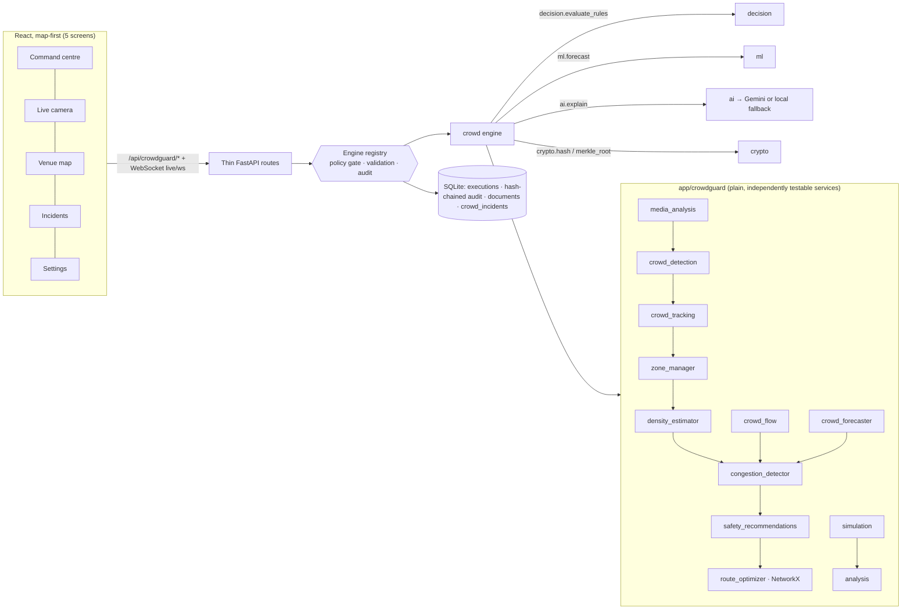

# CROWDGUARD — Architecture

CROWDGUARD is a crowd-safety monitoring prototype for public events, built on the OMNIFORGE framework. It includes
the Virtual Crowd Intelligence Engine (VCIE), which turns oblique camera footage into a calibrated bird's-eye density, movement and
digital-twin view.
It estimates how many people are in each zone, flags overcrowding and dangerous build-up early, forecasts
capacity breaches, and proposes safer movement routes, with every number labelled as **observed**, **estimate**
or **synthetic**.

> CROWDGUARD does not certify that an event is safe. Its counts are estimates, not ground truth. Human
> organisers make every intervention decision, and no software recommendation can close or restrict an emergency exit.

## 1. Run it

```bash
cd backend && python -m uvicorn app.main:app --port 8000      # API + built UI at http://127.0.0.1:8000
cd frontend && npm run build                                   # (re)build the UI that FastAPI serves
# or for UI development: cd frontend && npm run dev            # http://localhost:5173 (proxies /api)
```

Optional environment variables (see `.env.example`):

| Variable | Default | Purpose |
|---|---|---|
| `CROWDGUARD_YOLO_WEIGHTS` | auto-search | Path to a local YOLO `.pt` file. **Nothing is ever downloaded.** Search order: this variable, `backend/models/{yolo11n,yolov8n,…}.pt`, then the user's home folder. |
| `CROWDGUARD_DETECTOR` | `auto` | `auto` (YOLO, else OpenCV HOG), `yolo`, or `hog` |
| `CROWDGUARD_MAX_VIDEO_MB` | `100` | Upload cap for video |
| `GEMINI_API_KEY` | unset | Enables Gemini briefings via the existing AI provider abstraction; otherwise the labelled local fallback is used |

## 2. Shape of the system



The six OMNIFORGE engines (security, ai, ml, crypto, data, decision) and the nine original domain adapters are
unchanged. CROWDGUARD adds:

* **`crowd` engine** (`backend/app/engines/crowd/engine.py`): the seventh engine. It exposes the services as typed,
  policy-checked operations and *reuses* the other engines through the registry instead of re-implementing them.
* **`crowd_safety` domain adapter** (`backend/app/domains/adapters/crowd_safety.py`): the tenth adapter. A declarative
  pipeline (snapshot → backtested forecast → per-zone risk score → relief route → briefing → evidence hash) that runs in the
  generic OMNIFORGE workspace and is covered by the parametrised pipeline test.
* **`/api/crowdguard/*` routes** (`backend/app/api/crowdguard.py`): thin wrappers that call the engine through the registry,
  plus background jobs for media analysis.
* **Eight React screens** (`frontend/src/crowdguard/`), integrated into the enhanced OMNIFORGE shell from `feature/omniforge-frontend`.

## 2a. One analysis chain (integration)

Every source (recorded video, still image, synthetic VCIE scenario, synthetic festival) flows through the same stages, each with one implementation:

```
camera / video / simulation
  → frame sampling (media_analysis: ~5 fps, ≤30 s, ≤180 frames)          [non-blocking background job]
  → camera calibration (calibration.py: 4-point homography, validated)
  → person detection (crowd_detection.py: local YOLO or labelled HOG; detection.py projects to ground)
  → multi-object tracking (crowd_tracking.py ByteTrack identity → tracking.py ground-plane Kalman kinematics)
  → bird's-eye projection (perspective.py)
  → density (density.py Gaussian KDE in persons/m² · density_estimator.py zone estimate with interval)
  → zone population (zone_manager.py camera zones · density.py ground-plane zones)
  → congestion detection (congestion_detector.py rules via decision engine · movement.py flow alerts)
  → predictive analysis (crowd_forecaster.py + ml.forecast)
  → route optimisation (route_optimizer.py, NetworkX)
  → command centre (assess / simulate → React UI)
```

Provenance is explicit at every step. Frames carry `source_kind`: `recorded_video`, `image` or `synthetic` (no live camera
streaming is implemented, so nothing is ever labelled live). They also carry `detector_backend` (`yolo`, `hog`, or `synthetic ground truth`) and
`detection_failed`. Video jobs report whether the bird's-eye plane uses the **default preset** (rescaled, not a real calibration) or an
**operator calibration**.

## 3. Services (`backend/app/crowdguard/`)

| Module | Responsibility |
|---|---|
| `zone_manager.py` | Polygon zones, shoelace area, ray-casting point-in-polygon (edges count as inside), per-zone counts; overlapping zones resolve to the smallest polygon. People are assigned by their **foot point** (bottom-centre of the box). |
| `crowd_detection.py` | `YoloPersonDetector` (Ultralytics, person class only, local weights only, `YOLO_OFFLINE=true` so no downloads or telemetry) and `HogPersonDetector` (OpenCV, no weights). The status records what was searched, what loaded and whether a test inference passed. |
| `crowd_tracking.py` | `ByteTrackTracker` (Ultralytics BYTETracker fed with our detections) or a deterministic ByteTrack-style `IoUTracker` fallback. `TrackHistory` gives unique ids per zone, zone-to-zone transitions and fragmentation. Repeated detections of one person are never counted twice. |
| `density_estimator.py` | Occlusion-corrected estimate with an interval (`estimate = observed / recall(density)`), occupancy %, density, Fruin level of service, bands (normal / elevated / high / critical / **unknown**), a heuristic confidence and a data-quality label. Stale, missing and detector-error feeds carry the last value forward with a widening interval or report **unknown**, never zero. |
| `crowd_flow.py` | Track velocities (least squares over a window; px/s, or m/s with calibration), direction histogram, coherence, stationary and counter-flow share, the Weidmann speed–density relation, and net zone flow vectors from corridor flows. |
| `congestion_detector.py` | Twelve alert rules generated from venue thresholds in the decision engine's JSON DSL: overcrowded, near capacity, dangerous density, rapid build-up, forecast breach, slow queue (Little's law), slow crowd, stale feed, detection failure, low confidence, exit blocked and bottleneck. Evaluation is delegated to `decision.evaluate_rules`. |
| `crowd_forecaster.py` | Deterministic forecast: persistence for fewer than 3 points, a linear trend for fewer than 8, otherwise damped Holt. The band comes from out-of-sample residuals and widens with the horizon. Also time to capacity, a possible breach from the upper band, and a heuristic probability of exceeding capacity. `rolling_backtest` scores it against persistence. |
| `venue.py` | Venue config → NetworkX graph (zones, junctions, gates, exits). Corridor capacity = width × 82 people/m/min. |
| `route_optimizer.py` | Safety-weighted Dijkstra plus Yen k-shortest paths. Hard rules: never enter a high/critical zone (except the source), never pass through a service queue, avoid blocked corridors and exits, and destinations must have fresh data and spare capacity on the **upper** estimate (≤ 85 % after arrival). It splits the group across destinations and separately assesses the distance-shortest path, giving reasons when it is rejected. |
| `safety_recommendations.py` | Ranked, explained actions (relieve zone, meter entry, clear exit, re-route egress, verify feed, manage queue, steward bottleneck). Each one has `requires_human_decision = True`. `validate_action` refuses any restrictive action that targets an emergency exit. |
| `analysis.py` | One snapshot: readings → forecasts → facts → alerts → route state → recommendations → summary. Shared by simulation and live assessment. |
| `simulation.py` | The deterministic synthetic festival (see §5) and a counterfactual run without intervention. |
| `media_analysis.py` | Video/image ingestion: magic-byte sniffing and frame sampling (~5 fps, capped at 30 s / 180 frames), then each frame goes through the **VCIE pipeline**. It aggregates camera-zone counts, estimates and flow, and for key frames returns the raw frame with overlays plus the five synchronised VCIE views. It maps camera zones to venue zones, with coverage-based extrapolation labelled as such. |
| `calibration.py` / `perspective.py` | VCIE: four-point homography with convexity and conditioning checks; camera ↔ bird's-eye projection; metric grid. |
| `detection.py` | VCIE adapter over the single detector: `BoundingBox` conversion and ground-contact projection. |
| `tracking.py` | VCIE ground-plane Kalman filter (position, velocity, m/s). It takes ByteTrack ids for real footage and uses distance association only for synthetic agents. History is bounded. |
| `density.py` | VCIE Gaussian KDE density grid (persons/m²), ground-plane zone metrics (shared occupancy bands) and heatmap rendering (gaussian / point / zone / movement). |
| `movement.py` | VCIE movement vectors, bottleneck, counter-flow and severe-density alerts (advisory). |
| `digital_twin.py` / `synthetic.py` | VCIE digital-twin rendering, and four deterministic synthetic camera scenarios using ground-truth boxes (always labelled synthetic). |
| `pipeline.py` | VCIE orchestration per frame. It renders the five views only for key frames and caches them together, so they always come from the same frame. |

## 4. API (`/api/crowdguard`)

| Method & path | Engine op | Notes |
|---|---|---|
| `GET /venue` | `crowd.venue` | Zones, graph, thresholds, camera layouts |
| `GET /status` | `crowd.status` | Verified detector/weights, tracker, routing library, AI provider |
| `POST /simulation` | `crowd.simulate` | `{seed, intervention, exit_blockage, feed_outage, tick?}`. Full timeline, or one tick plus its history. Cached. |
| `POST /assess` | `crowd.assess` | Live observations → readings, alerts, recommendations. Zones without an observation are reported as **missing**, not empty. |
| `POST /route` | `crowd.route` | `{source, purpose: relieve|egress, group_size, tick or zones, blocked_edges, blocked_nodes}` |
| `POST /forecast` | `crowd.forecast` | Deterministic forecast, plus `ml.forecast` when there are at least 16 points, plus a rolling backtest |
| `GET /presets` | `crowd.vision_presets` | VCIE calibration preset, digital-twin venue, scenarios, heatmap modes, detector |
| `POST /calibration` | `crowd.vision_calibrate` | **write**: validate a 4-point homography; applies to the live view and to later video jobs |
| `POST /simulation/step`, `POST /simulation/reset` | `crowd.vision_step` | Synthetic VCIE frame: telemetry plus all five views of that frame (base64 JPEG) |
| `GET /analysis/live/{view}` | — | Latest synthetic VCIE view as JPEG (`frame`, `birdseye`, `heatmap`, `movement`, `digitaltwin`, `tracks`) |
| `GET /media/jobs` | — | Recent media jobs of this process (ids, status, filename) |
| `POST /explain` | `crowd.explain` | `ai.explain` briefing (Gemini if configured, otherwise local fallback; the provider is reported) |
| `POST /media`, `POST /media/sample`, `GET /media/jobs/{id}` | `crowd.analyse_media` | Background job with progress. Uploads are stored by SHA-256 and audited. |
| `GET/POST /incidents`, `POST /incidents/{id}/actions`, `GET /incidents/{id}/verify` | `crowd.incident_*` | Human-only lifecycle with a four-eyes close, hash-chained events and a Merkle seal |

Each response is the standard OMNIFORGE envelope (`success, result, warnings, metadata, error`), and each call is recorded in
`executions` and, for writes, in the hash-chained audit log. Simulation responses are gzip-compressed (~130 KB for 66 minutes).

## 5. The demonstration scenario (synthetic, deterministic)

Riverside Open-Air Festival (fictional): 8 zones, 2 junctions, 2 gates and 2 emergency exits, from 18:00 to 19:05, seed 2026.
It uses a macroscopic reservoir model with corridor throughput caps that depend on density. A synthetic camera per zone undercounts
with density, and the normal estimator turns its readings into estimates. Each scenario event comes from the alerts the system actually raised:

| Clock | What happens |
|---|---|
| 18:20 | First warning: Main Stage filling at ≥ 2 % of capacity per minute (52 %). Simulated incident INC-SIM-001 opened. |
| 18:26 | Bar-queue camera returns detector errors for 2 min. Shown as "detection failed", not as an empty zone. |
| 18:32 | Forecast predicts a capacity breach; near-capacity alert. The route planner proposes a relief route. |
| 18:37 | Main Stage over safe capacity (critical). |
| 18:40 | Organisers approve the recommendation (simulated): entry metered, arrivals redirected, relief to Second Stage and Food Court. |
| 18:41 | Peak at ~104.6 % (estimate). Without the intervention the same scenario peaks at ~158 % (counterfactual). |
| 18:44 | East Emergency Exit E1 obstructed. Exit-blocked alert; egress is re-planned to W1 / North Gate. |
| 18:49–18:53 | Food Court camera drops out. Stale-feed alert; the planner stops using Food Court as a destination. |
| 18:57 → 19:04 | Main Stage back below 85 %, then resolved after 5 stable minutes. E1 cleared at 18:58. |

Forecast check (rolling origin, 10-min horizon, Main Stage): MAE ≈ 1,125 people vs persistence ≈ 1,506. These figures come
from the synthetic scenario only and say nothing about accuracy on real cameras.

## 6. Safety and reliability decisions

* **Unknown ≠ zero.** Feed states are `ok | stale | missing | detector_error`. Unusable feeds carry the last value forward
  with drift-widened bounds and decaying confidence, or report `unknown`. Alerts fire for them, attendance totals say they exclude
  unknown zones, and routing never chooses an unverified destination.
* **Estimates carry uncertainty.** The occlusion model (recall 0.95 → 0.55 as density rises, ±0.08) and Poisson-like counting
  noise give an interval. Confidence values are heuristic and labelled as such. All thresholds are illustrative and must be calibrated per venue.
* **Shortest ≠ safe.** The distance-shortest path is always assessed against the hard rules and reported with pass/fail per check.
* **Human in the loop.** Recommendations are advisory. Incident transitions need a human actor (AI actors are capped at read by the policy gate),
  and closing needs a second person.
* **Emergency exits.** `validate_action` refuses restrictive actions on emergency exits. The planner treats a blocked exit as an
  observed condition to route around and to clear; it never proposes closing one.
* **Integrity, without blockchain.** Incident evidence is SHA-256-hashed via the crypto engine, events are hash-chained, and closure is sealed
  with an RFC 6962-style Merkle root. `verify` recomputes all three, and a test edits the DB row and confirms tampering is detected.
* **Privacy.** No face recognition or re-identification is used. Track ids are ephemeral, and uploads are stored by hash on the local machine.

## 6a. Frontend

React 19, Vite and Tailwind v4 (Recharts was removed). The app opens on the Command centre; there is no domain selector. Five screens,
each lazy-loaded:

* **Command centre**: the live top-down map (cell states, density heatmap, people, movement, route) with source, layers, zones and exits on
  the left and area, alerts and the recommended route on the right.
* **Live camera**: the analysed frame with boxes and foot points, four-click floor calibration with measured dimensions, a compact map and
  the tracked-people table.
* **Venue map**: the monitored-area editor (walkable outline, obstacles, zones, exits, grid and thresholds) and, on a second tab, the
  zone-level simulated festival with forecast and relief recommendations.
* **Incidents**: incidents opened by people from live alerts, their hash-chained lifecycle, and audit-chain status.
* **Settings**: theme, operator identity, detector and device, and how to read the numbers.

The live pipeline, transport and map are described in [`CROWDGUARD_REALTIME_ARCHITECTURE.md`](CROWDGUARD_REALTIME_ARCHITECTURE.md).

**Themes.** `ThemeProvider` (light, dark or system) persists the preference and follows the OS in system mode. An inline script applies
the theme class before first paint, so there is no flash. All colours are CSS tokens on `:root` / `:root.dark`, and `dark:` utilities follow the
resolved class. On a switch, `.theme-transition` is added to `<html>` for about 300 ms, so backgrounds, text, borders, inputs and SVG fills and strokes ease together
(260 ms, `cubic-bezier(.2,.6,.2,1)`). This is disabled under `prefers-reduced-motion`. Charts read the resolved theme for their SVG colours.

## 7. Verified vs fallback in this build

| Capability | Status on the build machine |
|---|---|
| YOLO person detection | **Verified**: `yolov8n.pt` at the repository root (committed on the VCIE branch; Ultralytics weights are AGPL-3.0) and a test inference passed. `YOLO_OFFLINE=true` prevents downloads. |
| Tracking | **Verified**: Ultralytics BYTETracker (IoU tracker kept as fallback) |
| Routing | NetworkX 3.6.1 |
| LLM | **Not configured**: briefings use the deterministic local fallback and are labelled. The Gemini path was not exercised live. |
| Video test asset | A camera pan synthesised from Ultralytics' `bus.jpg`: detections are real, motion is artificial (labelled). No real crowd footage was available. |

## 8. Known limitations

* The macroscopic simulator is a demonstration model, not a validated pedestrian simulation.
* Camera zone polygons and metres-per-pixel must be configured per camera. Without calibration, speeds are px/s.
* The occlusion model is a generic assumption. Calibrate it against manual counts before trusting absolute numbers.
* Media jobs and the simulation cache are in-memory (lost on restart). Processing caps each job at 30 s of video. Ultralytics uses a GPU automatically when one is available; this build was CPU-only.
* There is no live camera streaming. Footage is analysed as recordings. The live synthetic VCIE pipeline is shared by everyone using the server.
* The VCIE default calibration is a demo preset rescaled to each frame. Ground-plane densities and speeds are metric only after an operator calibrates four real ground points.
* Identity is still the simulated OMNIFORGE header identity. Put real authentication in front before any deployment.
